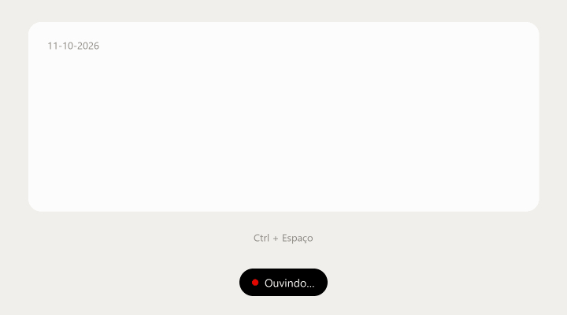

# Pluto Assistant

Ditado por voz para Windows que roda na sua máquina. Você segura um atalho, fala, solta, e o texto já sai limpo: colado onde o cursor estiver, ou na nota do dia de uma pasta do Obsidian.



Não há conta, não há API e o áudio não sai do computador. A transcrição usa o [faster-whisper](https://github.com/SYSTRAN/faster-whisper). Se houver uma GPU NVIDIA, o Pluto usa CUDA; se não houver, cai para a CPU.

## Como usar

O Pluto fica na bandeja do sistema, sem janela aberta.

1. Segure `Ctrl + Espaço`.
2. Fale.
3. Solte o atalho.

Uma pílula preta aparece perto da base da tela: ponto vermelho pulsando enquanto ouve, branco enquanto transcreve. Toques curtos demais (menos de 0,4 s) são ignorados.

O texto passa por uma limpeza em português antes de ser entregue: vícios de linguagem (`hum`, `né`, `tipo assim`…), repetições, espaçamento, capitalização e pontuação. Dá para cadastrar nomes no dicionário, para o reconhecedor acertar melhor, e snippets de voz, em que uma frase vira um texto fixo (por exemplo, "meu linkedin" vira a URL do seu perfil).

Pelo ícone da bandeja: ativar ou pausar, abrir configurações, ver o histórico ou sair.

## Para onde o texto vai

**Cursor.** Com a pasta do Obsidian vazia, o Pluto cola o texto no aplicativo que estiver em foco e devolve o que estava na área de transferência.

**Nota do dia.** Com uma pasta preenchida nas configurações, cada fala entra no arquivo daquele dia, no formato `DD-MM-AAAA.md` (por exemplo, `11-10-2026.md`). Se o arquivo não existir, ele é criado. Cada fala fica em uma linha.

Dizer **nova anotação** não grava essas palavras. Grava um separador do Markdown, com uma linha em branco antes e outra depois. O que você disser na mesma fala entra embaixo.

```markdown
Comprei pão de manhã.

---

Reunião adiada para quinta.
```

A pasta precisa existir. O Pluto não cria o cofre, só a nota do dia dentro dele.

## Requisitos

- Windows
- Python 3.11 ou mais novo, disponível no `PATH`
- Microfone
- GPU NVIDIA é opcional. Sem ela, a transcrição roda na CPU com um modelo menor

Na primeira execução o modelo é baixado (cache do Hugging Face) e carregado uma vez. Com GPU, o padrão é `large-v3-turbo`. Na CPU, `small`.

## Instalar e abrir

```bat
run.bat
```

O script cria o ambiente virtual, instala as dependências e abre o Pluto sem console. Para ver os logs na hora:

```bat
run-debug.bat
```

As duas linhas `nvidia-cublas-cu12` e `nvidia-cudnn-cu12` em `requirements.txt` são a aceleração CUDA. Em um PC sem GPU NVIDIA, pode removê-las antes de instalar.

## Configurações

Atalho, microfone, modelo, pasta do Obsidian, dicionário, snippets e vícios de linguagem ficam na janela de configurações. O arquivo salvo é:

```text
%APPDATA%\PlutoAssistent\config.json
```

O atalho usa o formato do `pynput`, por exemplo `<ctrl>+<space>`, `<ctrl>+<alt>+d` ou `<f9>`. Trocar o modelo ou o dispositivo (GPU/CPU) pede reinício. O restante vale na hora.

## Testes

```bat
.venv\Scripts\python.exe -m pytest
```

Áudio, atalho global, pílula e bandeja se conferem usando o programa.
